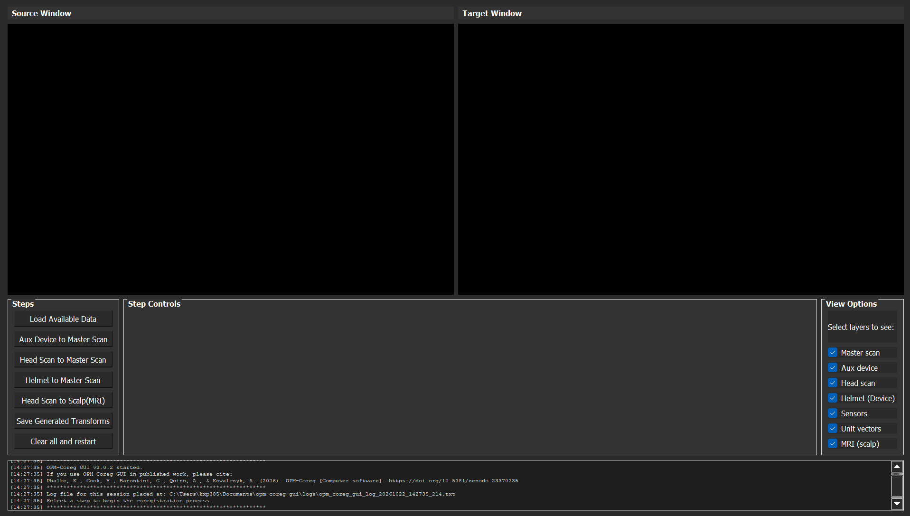

# OPM-Coreg

OPM-Coreg is an open-source graphical user interface (GUI) for co-registering Optically Pumped Magnetometer (OPM) sensors and auxiliary devices with anatomical MRI data.

The software provides tools for aligning 3D scans, MRI-derived surfaces, sensor locations, and external devices within a common coordinate system, enabling accurate source localisation and integration with neuroimaging workflows.

---

## Quick Links

- 💾 [Download Windows Installer](https://github.com/QN-lab/OPM-Coreg/releases)
- 📦 [Install from PyPI](https://pypi.org/project/opm-coreg/)
- 💻 [Source Code](https://github.com/QN-lab/OPM-Coreg)
- 📚 [Zenodo Archive](https://doi.org/10.5281/zenodo.23370235)

---

## Documentation

- [Installation Guide](installation.md)
- [Usage Guide](usage.md)

---

## Citation

If OPM-Coreg contributes to your research, please cite:

> Phalke, K., Cook, H., Barontini, G., Quinn, A., & Kowalczyk, A. (2026). *OPM-Coreg* [Computer software]. https://doi.org/10.5281/zenodo.23370235

DOI:

https://doi.org/10.5281/zenodo.23370235

---

## Tutorials and Datasets

- [Tutorial 1 : Introduction and Overview](https://youtu.be/R4KlEnG1vWw?si=KVwxuCuargE3uRyF)
- [Tutorial 2 : Co-registration Workflow](https://youtu.be/WsxPJTaDlk0?si=it3139iHXrxds9Zb)
- [OPM-Coreg GUI Tutorial Dataset 01](https://doi.org/10.5281/zenodo.23806985)

---

## License

OPM-Coreg is distributed under the BSD 3-Clause License.
